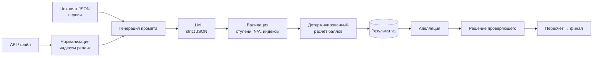

# Архитектура

> [!note] Черновик до старта. Финальное решение фиксируем в [[07 Решения (ADR)]].

## Стек (предложение)
| Слой | Выбор | Почему |
|---|---|---|
| UI | Vite + TypeScript + Tailwind, сборка в статический `dist/` (по возможности один HTML-файл) | На выходе чистые HTML/CSS/JS → требование R-15 и Dynamics 365 web resource |
| Бэкенд | Node + TypeScript (Express/Hono) | Один язык с UI, прокси к API (CORS) |
| Хранилище | SQLite (или JSON-файлы) | Без установки, переносимо |
| LLM | Облако (Claude) + опционально локальная через OpenAI-совместимый endpoint (Ollama) | Точность + «разнообразие архитектур» |

## Поток оценки

## Сущности
- `Checklist { id, version, sections[], criteria[] }`, критерий: `id, title, description, type(binary|scale), steps[], na_allowed, na_condition, weight, section, is_gross`
- `Conversation` — как в API
- `Evaluation { conversation_id, checklist_version, model, cost, items[], total, sections{}, gross, created_at }`
- `Appeal { evaluation_id, criterion_id, comment, status, reviewer_decision, reviewer_reason, new_answer }`

## Dynamics 365
UI не зависит от бэкенд-фреймворка: `API_BASE` берётся из конфига/параметра URL; никаких абсолютных путей; один бандл.
